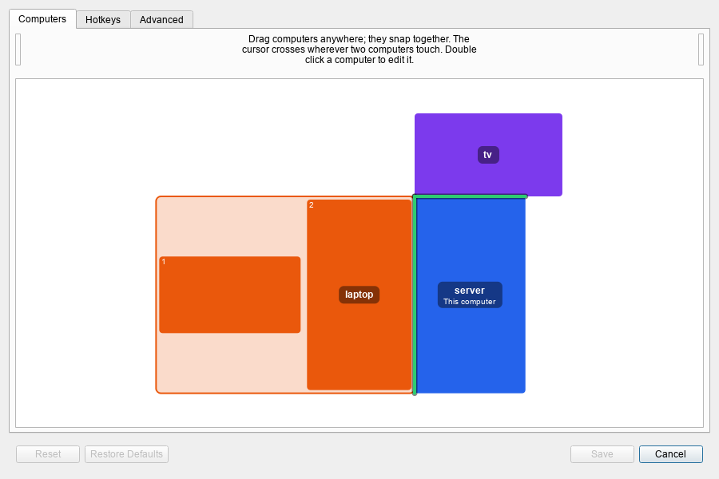

# Deskflow Plus

**Deskflow Plus** is a fork of [Deskflow](https://github.com/deskflow/deskflow), the free and open source
keyboard and mouse sharing app. Use the keyboard and mouse of one computer to control the computers next
to it, as if their screens were one big desktop: a software KVM, without the video.

Deskflow Plus keeps everything Deskflow does and adds a free-form screen layout and file transfer
between computers, in the spirit of ShareMouse and Mouse Without Borders.

> [!NOTE]
> **Deskflow Plus and Deskflow.** Deskflow Plus is an independent fork, maintained separately from the
> Deskflow project. It periodically pulls in changes and fixes from Deskflow as needed, so it stays close to
> the original, but it isn't made or supported by the Deskflow team. Please report problems with
> Deskflow Plus [here](https://github.com/wesleypayton/deskflow-plus/issues), not to Deskflow.

<picture>
  <source media="(prefers-color-scheme: dark)" srcset="../docs/images/layout-canvas-dark.png">
  <source media="(prefers-color-scheme: light)" srcset="../docs/images/layout-canvas-light.png">
  
</picture>

## What Deskflow does

- Share one keyboard and mouse between computers on your network, moving across by pushing the cursor
  off the edge of a screen
- Share the clipboard between computers
- Hotkeys, screen locking and switching options
- TLS encryption, on by default
- Windows, macOS, Linux (including Wayland) and BSD

## What Deskflow Plus adds

- **Free-form layout.** The fixed grid of screens is replaced by a canvas where you drag computers anywhere.
  They snap together, and green lines show exactly where the cursor will cross. Computers no longer have
  to line up: a laptop can sit against the lower half of a tall monitor, and the cursor crosses only
  where they actually touch.
- **Real monitor arrangements.** Each computer is drawn as its own monitors, arranged as Windows has them,
  portrait screens included, in its own colour so you can tell computers apart.
- **Copy and paste files.** Copy files or folders in Explorer, move to another computer and paste them there.
  Progress shows in the app's status bar, and a notification says when files arrive.
- **Drag files across.** Drag files in Explorer to the edge of the screen and keep holding: the cursor
  crosses to the next computer, and releasing drops the files into the folder or desktop under the cursor.
- **Use any computer's mouse and keyboard.** A client's own mouse crosses to the server and on to the other
  computers, as in Mouse Without Borders, and its keyboard follows. Bring the cursor back to the client and
  its mouse and keyboard work there again.

Files are sent through the server, encrypted with the rest of the connection, and are never written
outside the folder they're dropped in. More detail is in the [design notes](../docs/dev/layout-rework.md).

## Status

Deskflow Plus is **Windows only** for now, and early: the new features have been tested on one PC but not
yet across many setups. Expect rough edges, and please report what you find.

Builds for macOS and Linux will come once the features are in good shape. They'll be marked as untested
until someone has tried them, and the new features may not work there at first.

- The layout is set up on the server, so it works with any client. Copying and dragging files, showing a
  client's real monitors, and using a client's own mouse and keyboard need Deskflow Plus on both computers.
- Deskflow Plus still works with stock Deskflow, Input Leap and Barrier computers for mouse, keyboard and
  clipboard sharing.

## Download

Get the latest build from [Releases](https://github.com/wesleypayton/deskflow-plus/releases):

- **`...-setup.exe`** installs Deskflow Plus, along with the Microsoft Visual C++ runtime if it's missing.
  It installs as its own app, so it won't replace an official Deskflow install.
- **`...-portable.exe`** unpacks a portable copy into a folder you choose, with its settings kept in that
  folder. The portable copy can't control the login screen or administrator (UAC) prompts.

Each release lists the SHA-256 checksum of its files. To check a download, compare it with the output of
`Get-FileHash <file>` in PowerShell.

The files aren't code signed, so Windows SmartScreen will warn the first time: choose **More info**, then
**Run anyway**. Deskflow Plus and Deskflow share their settings and network port, so don't run both at once.

> [!NOTE]
> Deskflow Plus needs the Microsoft Visual C++ Redistributable. The setup installs it for you and the
> portable copy carries its own, so you shouldn't need it separately. If Windows reports a missing
> `VCRUNTIME140` or `MSVCP140` DLL, install the latest
> [`vc_redist.x64.exe`](https://aka.ms/vc14/vc_redist.x64.exe)
> ([details from Microsoft](https://learn.microsoft.com/en-us/cpp/windows/latest-supported-vc-redist)).

## Quick start

Install or unpack Deskflow Plus on each computer, then:

1. **Before you start**, quit Mouse Without Borders, ShareMouse and Deskflow on both computers, so only one
   program is sharing the mouse and clipboard.
2. **On the computer whose keyboard and mouse you'll use (the server)**, open Deskflow Plus and choose
   **Server**. When Windows asks about network access, allow it on private networks.
3. **On the other computer (the client)**, choose **Client**, enter the server's IP address or computer
   name, and start it. Allow network access here too.
4. **Accept the security prompt** on both computers the first time they connect. It shows each side's
   fingerprint so you know you're talking to the right computer.
5. **Add the client** when the server asks about an unrecognised computer. It's placed next to the server.
6. **Arrange the computers** in **Configure Server → Computers**: drag each one to where it sits on your
   desk, check the green lines are where you expect the cursor to cross, and click **Save**.

Dragging files works as soon as both computers are connected. Copying and pasting files also needs
clipboard sharing left on (**Configure Server → Advanced**), where **Copied files limit** sets how much can
be copied at once (512 MB by default, 0 turns it off).

## Known limitations

- **Windows only.** The new features have only been built and tested on Windows.
- **One client's mouse at a time.** If two people at two clients both move onto other computers, the
  one who crossed last takes over, and the other's mouse goes back to working on their own computer.
- **A client's mouse can't carry a file drag across**, and it doesn't cross while one of its buttons is held,
  so dragging a window against the edge still snaps it.
- **Crossing follows each computer's outline, not its monitors.** With two monitors of different heights,
  the cursor can only cross where the computer's overall outline touches the next computer.
- **Not yet tried on two separate computers**: using a client's own mouse and keyboard on other computers,
  dropping into an open folder or onto the desktop, dropping into the right tab of an Explorer window with
  several, and dragging files that start on a client.
- **The portable copy can't control the login screen or UAC prompts**, as it doesn't include the
  background service.
- **Not code signed**, so Windows warns before running the downloads.

## Roadmap

- Crossing between individual monitors rather than each computer's outline
- Untested macOS and Linux builds, once the features are in good shape

## Troubleshooting

- **The computers don't connect.** Check both are on the same network, that Windows allowed Deskflow Plus
  through the firewall (look for Deskflow Plus or Deskflow in Windows Defender Firewall's allowed apps), and that
  Deskflow, Mouse Without Borders and ShareMouse aren't running.
- **Windows blocks the download.** Choose **More info**, then **Run anyway**. The files aren't code signed.
- **A missing DLL error.** Install the Visual C++ Redistributable linked under [Download](#download).
- **Files don't copy or drop.** Make sure both computers run Deskflow Plus. For copy and paste, clipboard
  sharing must be on, and copies over the copied files limit are skipped. The status bar and a
  notification say when a transfer fails, and why.

To report a problem, turn up the logging first: in **Settings**, set the log level to **Debug**, try again,
then [open an issue](https://github.com/wesleypayton/deskflow-plus/issues) with what you did, which
computer was the server, and the log lines from around that time. Lines mentioning `drag probe`,
`offers`, `carrying`, `sending … files` or `file transfer failed` help most with file transfer problems.

## Uninstalling

- **Installed copy:** open **Settings → Apps → Installed apps**, find **Deskflow Plus**, and choose
  **Uninstall**. This removes the background service and firewall rules too.
- **Portable copy:** quit it and delete its folder. Its settings are in that folder and go with it.

Files received through copy and paste are kept in a temporary folder, `%TEMP%\Deskflow\Clipboard`; ones
more than a day old are cleared out the next time files are copied to that computer. Dragged files stay
where you dropped them.

## Building

Build it the same way as Deskflow: see [docs/dev/build.md](../docs/dev/build.md). After building a Release
configuration on Windows, [`deploy/windows/make-release.ps1`](../deploy/windows/make-release.ps1) makes the
setup and portable `.exe` files.

## Credits

Deskflow Plus is built on [Deskflow](https://github.com/deskflow/deskflow) and owes everything else to it
and its contributors. Deskflow began as Synergy, created by Chris Schoeneman in 2001; read its
[history](https://github.com/deskflow/deskflow/wiki/History).

- Deskflow: [github.com/deskflow/deskflow](https://github.com/deskflow/deskflow)
- Deskflow contributors: [contributors](https://github.com/deskflow/deskflow/graphs/contributors)
- Similar projects: [Input Leap](https://github.com/input-leap/input-leap), [Lan Mouse](https://github.com/feschber/lan-mouse), [Synergy](https://symless.com/synergy)

## AI disclosure

The Deskflow Plus additions (the free-form layout, monitor reporting, file transfer and Windows
packaging) were coded with **Claude Opus 5.5**, an AI model made by Anthropic, working under the
maintainer's direction. The original Deskflow code it builds on was written by the Deskflow contributors.

## License

Like Deskflow, this project is licensed under [GPL-2.0](../LICENSE) with an
[OpenSSL exception](../LICENSES/LicenseRef-OpenSSL-Exception.txt).
